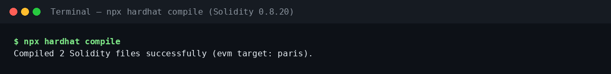
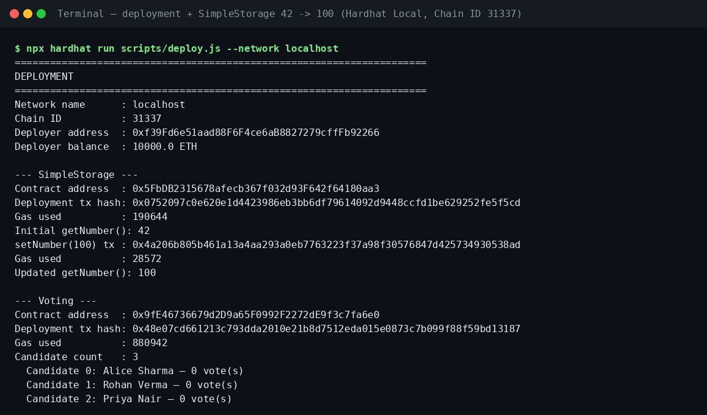
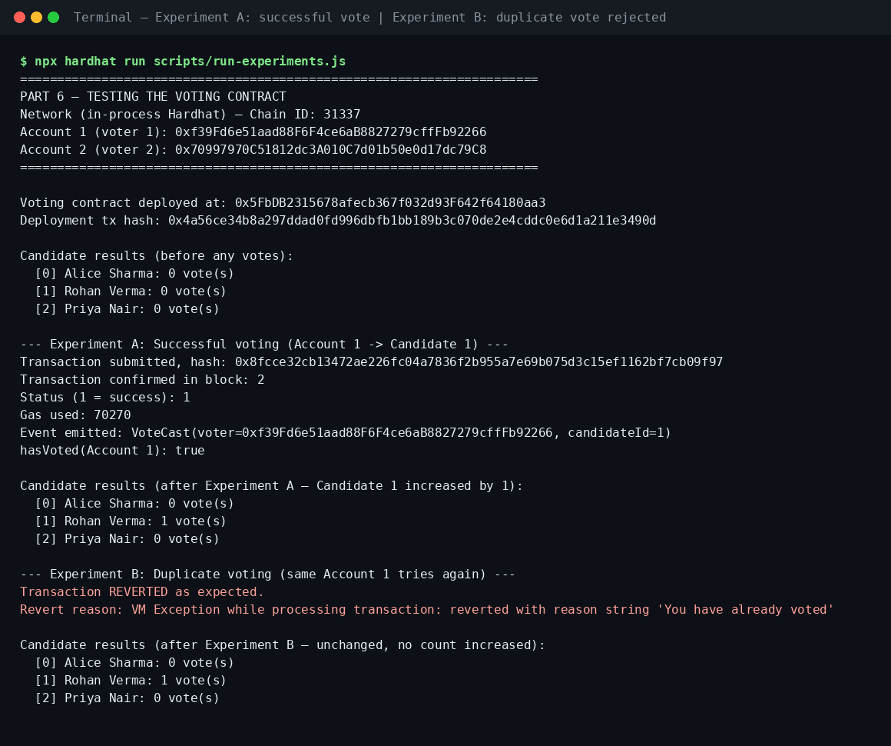
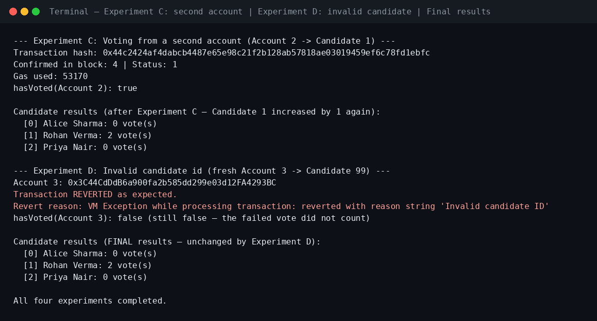
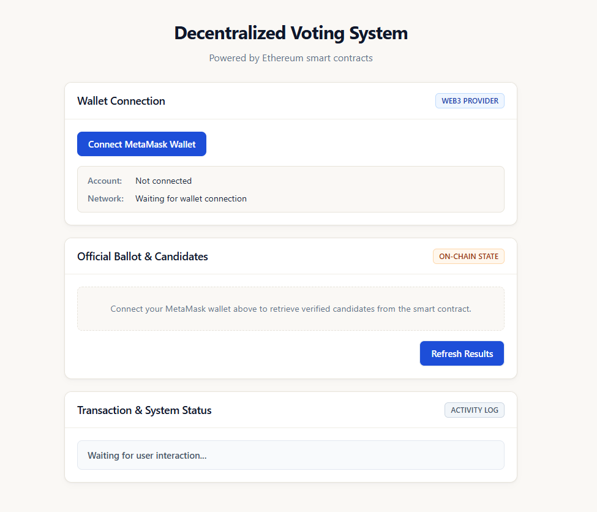
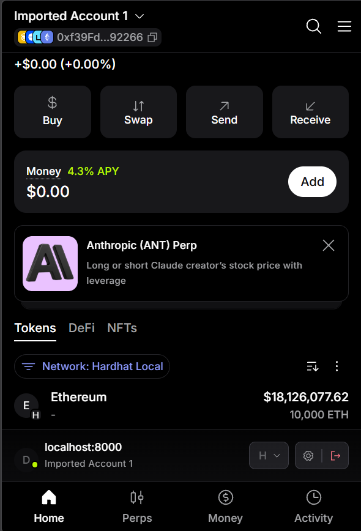
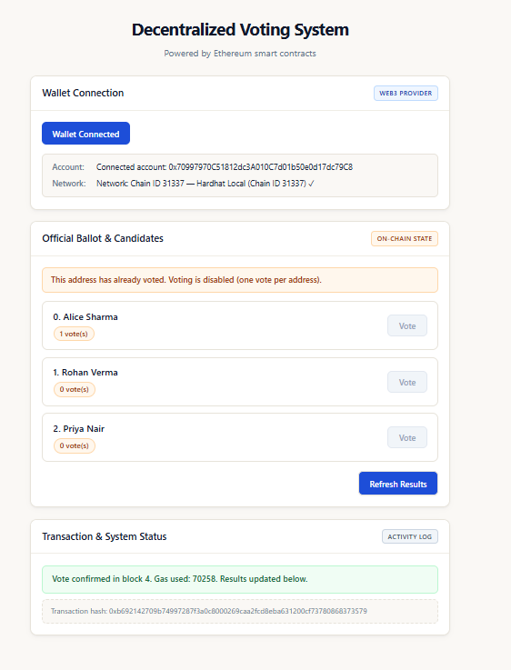
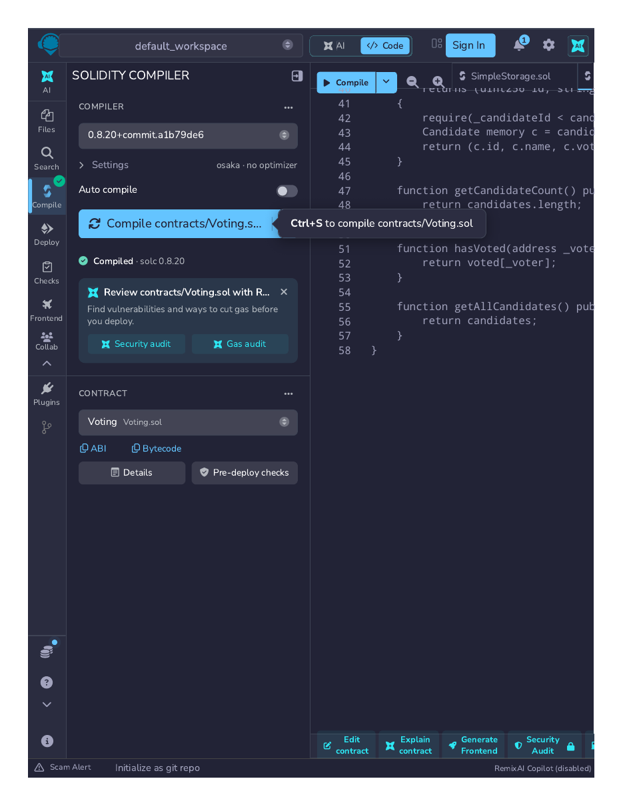
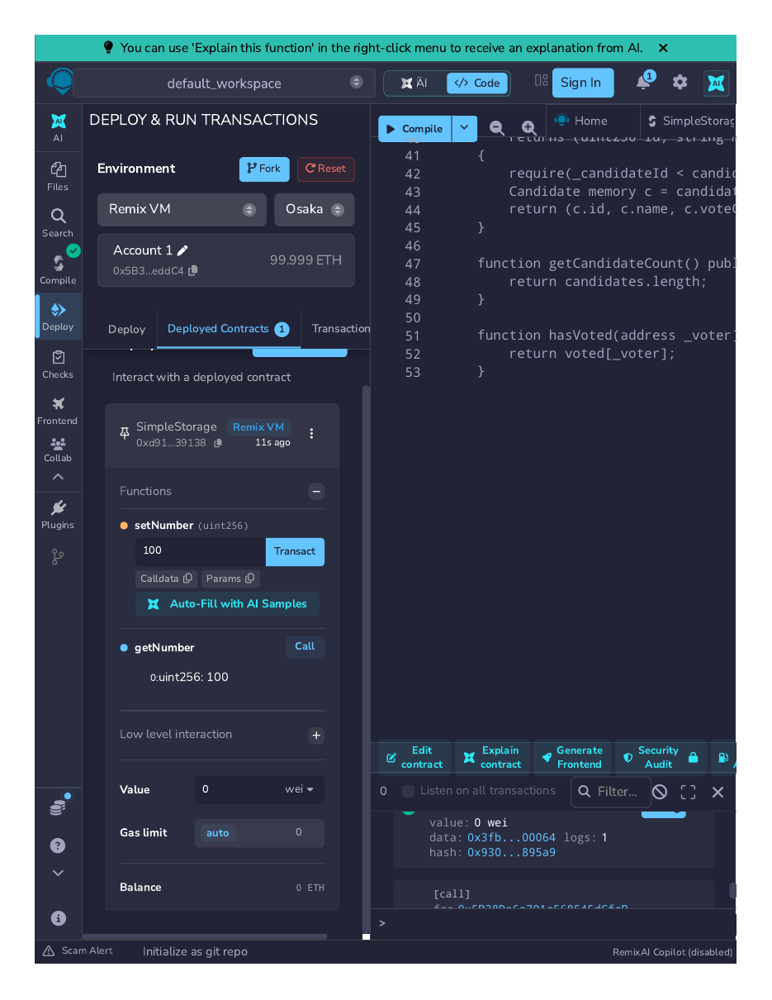
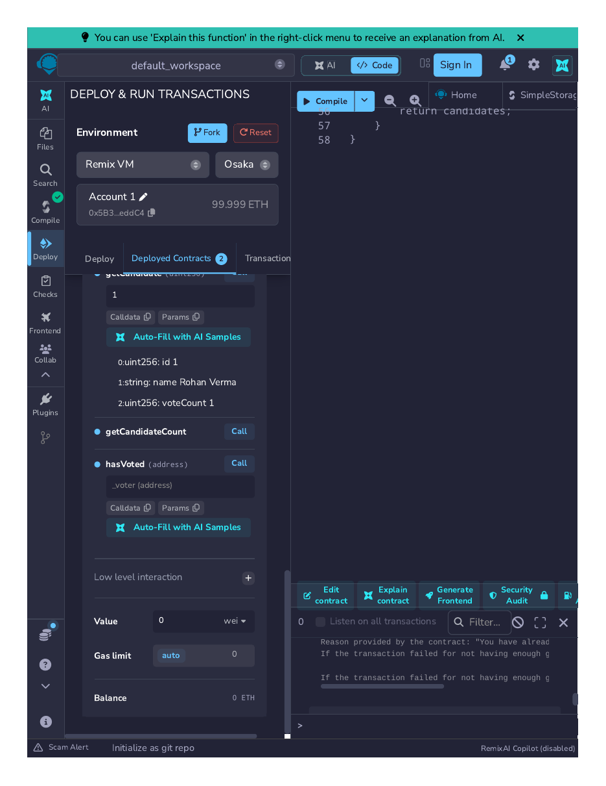

# Blockchain Technology — Practical Lab Submission

**Course:** Blockchain Technology — Practical Lab, Department of Computer Science, School of Technology, Doon University  
**Student:** Shreyas Lingwal  
**Assignment:** Introduction to Ethereum, Smart Contracts and DApp Development  

## Selected Network

| Item | Value |
| --- | --- |
| Network | Hardhat local development network (no real cryptocurrency) |
| RPC URL | `http://127.0.0.1:8545` |
| Chain ID | `31337` |
| Voting contract address (verified local deployment) | `0x9fE46736679d2D9a65F0992F2272dE9f3c7fa6e0` |
| SimpleStorage contract address (verified local deployment) | `0x5FbDB2315678afecb367f032d93F642f64180aa3` |
| Solidity version | 0.8.20 |
| Frontend library | ethers.js v6 (CDN) |

## Project Layout

```text
code/
├── contracts/
│   ├── SimpleStorage.sol   Part 2/3 storage contract
│   └── Voting.sol          Part 4 voting contract
├── frontend/
│   ├── index.html          DApp page
│   ├── style.css           DApp styling
│   └── app.js              Wallet connection, voting, error handling (ethers.js v6)
├── scripts/
│   ├── deploy.js           Deploys contracts, prints addresses, tx hashes and gas
│   └── run-experiments.js  Part 6 experiments A–D with full output logs
├── screenshots/            Execution evidence screenshots (1-10)
├── hardhat.config.js       Network configuration (localhost Chain ID 31337)
├── package.json            Dependencies and project scripts
└── package-lock.json       Locked dependency tree
```

## Prerequisites

- Node.js 18+ and npm
- MetaMask browser extension (for DApp interaction)
- No real ETH required; test accounts with 10,000 test ETH are provided by Hardhat.

## Step 1 — Install Dependencies and Compile

```bash
cd code
npm install
npx hardhat compile
```

Expected output: `Compiled 2 Solidity files successfully (evm target: paris).`



## Step 2 — Start Local Blockchain (Terminal 1)

```bash
cd code
npx hardhat node
```

This starts a local Ethereum-compatible node (Chain ID 31337) with 20 pre-funded test accounts containing 10,000 test ETH each. Keep this terminal running.

## Step 3 — Deploy Contracts (Terminal 2)

```bash
cd code
npx hardhat run scripts/deploy.js --network localhost
```

The script deploys `SimpleStorage` with initial value 42, calls `setNumber(100)`, and deploys `Voting` with three candidates (Alice Sharma, Rohan Verma, Priya Nair). It prints contract addresses, transaction hashes, and gas consumed.



## Step 4 — Run Experiments A–D (Terminal 2)

```bash
cd code
npx hardhat run scripts/run-experiments.js
```

This script verifies contract rules through automated experiments:
- **Experiment A:** Successful voting transaction from Account 1.
- **Experiment B:** Duplicate vote attempt from Account 1 (rejected by `require(!voted[msg.sender])`).
- **Experiment C:** Successful voting from a fresh account (Account 2).
- **Experiment D:** Invalid candidate ID (rejected by `require(_candidateId < candidates.length)`).





## Step 5 — Launch and Interact with the DApp

1. Add the local network to MetaMask:
   - **Network Name:** `Hardhat Local`
   - **RPC URL:** `http://127.0.0.1:8545`
   - **Chain ID:** `31337`
   - **Currency Symbol:** `ETH`
2. Import a test account using any private key displayed by `npx hardhat node`.
3. Start the local web server:

   ```bash
   cd code/frontend
   python -m http.server 8000
   ```

4. Open `http://localhost:8000` in your browser.
5. Click **Connect MetaMask Wallet** to link your account.



6. Confirm the wallet connection in MetaMask:



7. Select a candidate and click **Vote**. MetaMask prompts for transaction confirmation. Once mined, candidate tallies and voter status update live on-chain:



## Alternative: Deployment via Remix IDE

1. Open [Remix IDE](https://remix.ethereum.org).
2. Create `SimpleStorage.sol` and `Voting.sol` under the `contracts/` directory in Remix using the source code in `code/contracts/`.
3. In **Solidity Compiler**, select version `0.8.20` and compile both contracts.



4. In **Deploy & Run Transactions**, choose environment **Injected Provider - MetaMask** (connected to Hardhat Local network) or **Remix VM**. Deploy `SimpleStorage` with initial value `42`.



5. Deploy `Voting` and test candidate queries and vote casting directly through Remix's contract interface.


